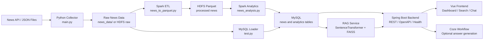

# Architecture And Defense Guide

这份文档用于课程答辩、项目复盘和简历讲解。核心目标是把项目从“能跑的代码”讲成一个有数据链路、有服务拆分、有工程化治理的新闻大数据分析平台。

## Project Positioning

一句话介绍：

> 基于 Spring Boot + Spark/Hadoop + Vue + FAISS 的新闻大数据分析与语义检索平台，支持新闻采集、HDFS 清洗、MySQL 持久化、统计分析可视化、向量检索和 RAG 问答。

适合写在简历中的项目名：

```text
新闻大数据分析与 RAG 语义检索平台
```

## Architecture



## Module Responsibilities

| Module | Responsibility | Resume Value |
| --- | --- | --- |
| `main.py` | 新闻数据采集，支持命令行参数和环境变量 | 数据接入与配置治理 |
| `news_to_parquet.py` | Spark 清洗 JSON 并写入 Parquet | 大数据 ETL 与存储优化 |
| `news_analysis.py` | Spark 统计分析并写入 MySQL | 离线分析链路 |
| `test.py` | HDFS/MySQL 数据加载 | 数据入库与批处理 |
| `src/` | Spring Boot 后端 API、健康检查、错误处理、OpenAPI | 后端工程化与 API 契约 |
| `rag-service/` | Flask + FAISS 语义检索服务 | RAG/向量检索微服务 |
| `news-frontend/` | Vue 可视化、搜索、问答页面 | 前后端联调与可视化 |
| `docker-compose.yaml` | MySQL、Hadoop、Spark、Redis、Mongo、RAG profile | 本地复现与部署编排 |
| `mysql/init/01-schema.sql` | MySQL 初始化建表脚本 | 数据库复现 |
| `docs/optimization/` | 每一步优化记录 | 答辩和简历材料沉淀 |

## Data Flow

1. 采集层：`main.py` 拉取新闻 JSON，密钥通过 `JUHE_APPKEY` 或命令行参数传入。
2. 存储层：原始 JSON 保存到本地或 HDFS raw 路径。
3. 清洗层：`news_to_parquet.py` 使用 Spark 清洗、去重，并写入 HDFS Parquet。
4. 分析层：`news_analysis.py` 读取 Parquet，统计类别、年份趋势、作者、热度等指标并写入 MySQL。
5. 服务层：Spring Boot 从 MySQL 暴露分页、统计、分析、健康检查和 RAG 问答 API。
6. 检索层：`rag-service/` 加载 SentenceTransformer 和 FAISS 索引，提供语义检索结果。
7. 展示层：Vue 前端调用后端 API，展示新闻列表、统计大屏和智能问答。

## Engineering Highlights

- 配置治理：数据库、Coze、RAG 地址、新闻采集密钥都改为环境变量，不再硬编码。
- API 契约：RAG 请求/响应、检索结果、错误响应使用 DTO，并通过 MockMvc 测试覆盖。
- 可观测性：新增 `/api/health`，返回服务状态和非敏感依赖配置摘要。
- 调试接口治理：移除默认暴露的临时测试接口，正式环境只保留业务 API。
- 可复现交付：根目录提供 `docker-compose.yaml` 和 `scripts/verify.ps1`。
- RAG 服务化：将 FAISS 检索从单脚本整理为可独立运行、可容器化的 Flask 服务。
- 大数据链路：采集、HDFS、Parquet、Spark 分析、MySQL、前端展示形成端到端闭环。

## Demo Order

1. 打开 README，介绍模块和启动方式。
2. 运行或展示 `scripts/verify.ps1` 的验证结果。
3. 打开 `http://localhost:8081/api/health`，证明后端可用。
4. 打开 `http://localhost:8081/swagger-ui.html`，展示正式 API 分组。
5. 展示 `docs/DATABASE_SCHEMA.md`，说明 MySQL 表结构和 Spark/RAG 读写路径。
6. 展示前端页面：新闻列表、统计图表、搜索/问答。
7. 展示 `docs/optimization/`，说明每一步优化都有问题、改法、价值和验证。
8. 展示 `docs/SUBMISSION_CHECKLIST.md`，说明提交范围、忽略的大文件和老师验收路径。
9. 最后用 `docs/optimization/resume-bullets.md` 说明项目能如何写进简历。

## Defense Talking Points

### 为什么使用 Spark/Hadoop？

新闻数据适合批量清洗、去重和聚合统计。Spark 负责计算，HDFS/Parquet 负责大数据场景下的分布式存储和列式读取，适合后续扩展到更大数据量。

### 为什么引入 FAISS？

传统关键词查询只能匹配字面词。FAISS 基于向量相似度检索，可以找出语义相关的新闻标题，为 RAG 问答提供上下文来源。

### 为什么把 RAG 做成独立服务？

向量模型和 FAISS 属于 Python 生态，Spring Boot 负责业务 API。拆成独立 Flask 服务后，职责更清晰，也方便后续单独替换模型、重建索引或容器化部署。

### 为什么要删除调试接口？

课程项目常有临时测试接口，但默认暴露会影响 API 契约和项目观感。删除根路径测试接口和 Coze 临时测试接口后，默认环境只保留正式业务入口，Swagger 文档也更干净。

### 项目有哪些工程化改造？

配置外置、Docker Compose 编排、OpenAPI 文档、统一错误响应、健康检查、MockMvc 测试、一键验证脚本、优化过程 Markdown 记录。

## Risk And Future Work

| Risk | Current Handling | Future Improvement |
| --- | --- | --- |
| RAG 质量依赖模型和索引数据 | 服务化并支持环境变量配置模型/索引路径 | 增加检索评测集和召回指标 |
| 前端依赖存在 npm audit 风险 | 已保证构建通过，不盲目升级 | 单独做依赖升级和回归测试 |
| Docker 首次拉取镜像较慢 | Compose 配置可校验 | 补充镜像版本锁定和离线镜像说明 |
| 数据规模有限 | Spark/HDFS 链路已参数化 | 补充更大规模测试数据和性能记录 |

## Final Resume Version

```text
新闻大数据分析与 RAG 语义检索平台
基于 Spring Boot、Spark/Hadoop、MySQL、Vue、SentenceTransformer 和 FAISS 构建新闻数据采集、清洗、分析、可视化与智能问答平台。负责数据采集与 Spark ETL 参数化、FAISS 语义检索服务化、后端 API 契约治理、OpenAPI 文档、健康检查、Docker Compose 编排和一键验证脚本，提升项目的可复现性、可维护性和答辩展示完整度。
```
